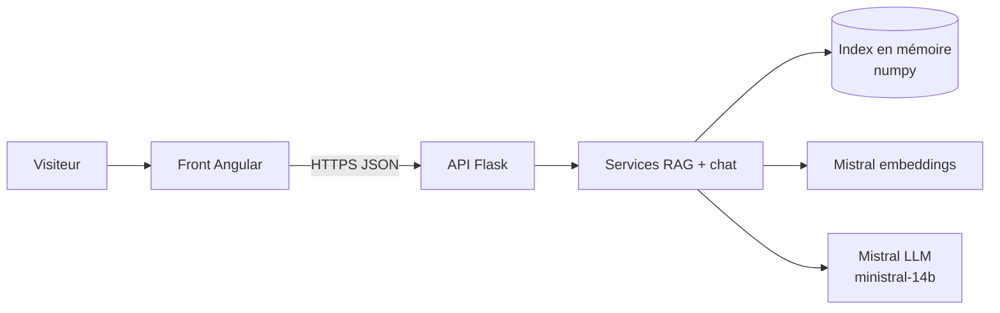

# Assistant documentaire IA - démo

Chatbot qui répond aux questions des clients d'une agence immobilière **fictive**
(Rivelune Immobilier, Lyon) à partir de ses documents PDF, en citant ses sources.
Il refuse le hors sujet et n'invente pas quand l'information manque.

Conception détaillée : [docs/CONCEPTION.md](docs/CONCEPTION.md).

## Architecture



Backend Flask en 3 couches :

| Couche | Rôle |
|---|---|
| `app/api/` | Routes, validation (pydantic), format d'erreur unique, rate limiting |
| `app/services/` | Découpage des PDF, recherche hybride (sens + références exactes comme `L-104`), prompt, filtrage des sources citées |
| `app/infra/` | Lecture PDF, clients Mistral, index numpy, quota journalier |

Changer de fournisseur IA = remplacer `llm_client.py` et `embeddings_client.py`.

Pas de base vectorielle : environ 30 morceaux de texte, une recherche numpy prend
moins d'une milliseconde. Au-delà de quelques milliers de morceaux : pgvector ou Qdrant.

## Lancer en local

```sh
cd backend
python -m venv .venv
.venv/Scripts/pip install -r requirements-dev.txt     # Linux/macOS : .venv/bin/pip
cp .env.example .env                                 # renseigner MISTRAL_API_KEY

python scripts/generate_pdfs.py    # crée les 4 PDF de l'agence fictive
python scripts/build_index.py      # découpe + embeddings -> data/index/
python scripts/eval.py             # 7 questions tests, score attendu 7/7
python wsgi.py                     # API sur http://localhost:5000
```

Tests (sans clé ni réseau, faux clients IA) :

```sh
python -m pytest -q
```

## API

| Méthode | Route | Rôle |
|---|---|---|
| GET | `/api/health` | État et nombre de morceaux indexés |
| GET | `/api/documents` | Liste des documents de l'agence |
| GET | `/api/documents/<id>/file` | Le PDF source |
| POST | `/api/ask` | `{question, history}` -> `{answer, sources, latency_ms}` |

Erreurs : `{"error": {"code", "message"}}` avec `invalid_question` (400),
`rate_limited` (429), `demo_paused` (503, quota du jour atteint),
`llm_unavailable` (502).

## Sécurité et coûts

- Clé API uniquement côté serveur (`.env`, jamais commité).
- Rate limit par IP (20/heure, 5/minute) et quota global de 300 questions par jour.
- Réponses limitées à 400 tokens, plafond de dépense à régler chez Mistral.
- CORS limité au domaine du front, `ProxyFix` pour la vraie IP derrière Render.
- Le prompt impose de répondre uniquement depuis les extraits et ignore les
  demandes de changement de rôle.

## Déploiement (Render)

- Build : `pip install -r requirements.txt`
- Start : `gunicorn wsgi:app --workers 1 --bind 0.0.0.0:$PORT`
  (1 worker : le rate limit et le quota sont en mémoire)
- Variables : celles de `.env.example`
- L'index `data/index/` est commité : aucun recalcul au démarrage.
